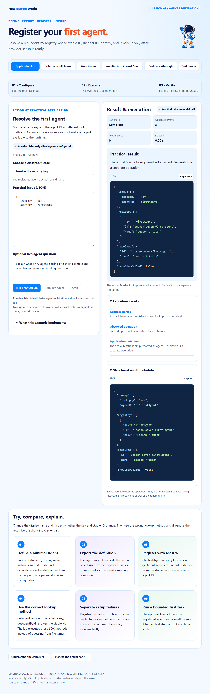

# Mastra · Lesson 07 · Building and Registering Your First Agent

Resolve a real agent by registry key or stable ID, inspect its identity, and invoke it only after provider setup is ready.



## Start

Use Node.js 24+. This is an independent repository.

```powershell
git clone https://github.com/luiscoco/Udemy-Mastra-lesson07-app.git
cd Udemy-Mastra-lesson07-app
npm ci
npm start
```

Open http://127.0.0.1:3207. **Run practical lab** executes: Actual Mastra agent registration and lookup · no model call. Starting the host makes no model call.

## Five student pages

Application lab · What you will learn · How to run · Architecture & workflow · Code walkthrough. They preserve the approved lesson 1 astronaut, typography, colors, light/dark theme, responsive layout, safe Markdown rendering, syntax colors and copy-code controls.

## Implemented exercise

Try the registry key and the agent ID as different lookup methods. A source module alone does not make an agent available to the runtime.

- **Resolve the registry key:** The registered agent's actual ID and name.
- **Use an ID as a key:** A lookup finding explaining the key/ID distinction.
- **Resolve the stable ID:** The same registered agent through getAgentById.

The local lab really resolves the registered agent. No tools, persistent memory or authentication system are added to this minimal first-agent example. Provider inference occurs only in live mode.

## Optional actual model run

Preserve any existing local configuration. No credential has been copied from another app.

```powershell
if (!(Test-Path .env)) { Copy-Item .env.example .env }
notepad .env
```

Enter your own provider key, choose a model your account can access, and restart. Keys stay on the server and are ignored by Git. Shell values take precedence over the optional file. Live generation may incur provider usage; the normal practical operation does not.

```dotenv
# Set your own provider credential locally. No credential is copied from another app.
OPENAI_API_KEY=your_api_key
MASTRA_MODEL=openai/gpt-4.1-mini
PORT=3207
```

## Build and test

```powershell
npm run sample
npm run sample:live
npm run build
npm test
npm run test:browser
```

The normal sample executes the real key-free operation. The live sample requires provider configuration. Offline SDK integration tests use Mastra's explicit model-test adapter and do not make paid model calls. Browser tests execute the real local lab, navigate all five pages, check responsive behavior and safe code rendering, and capture this app's own preview. Set BROWSER_EXECUTABLE for a nonstandard Chrome/Chromium path.

Source-linked excerpts and the browser script are generated from the actual implementation. Rebuild after editing source. Generated public files and dependency lockfiles are committed for reproducibility.

## Student exercise

Change the display name and inspect whether the key and stable ID change. Then use the wrong lookup method and diagnose the result before changing credentials.

## Key source files

- [src/lab.ts](src/lab.ts)
- [src/mastra/agents.ts](src/mastra/agents.ts)
- [src/mastra/index.ts](src/mastra/index.ts)
- [Request host](src/server.ts)
- [Execution envelope](src/runner.ts)
- [Student page generator](scripts/build-pages.ts)

## References

- [Approved lesson 1 baseline](https://github.com/luiscoco/Udemy-Mastra-lesson01-app)
- [Agent definition](https://mastra.ai/docs/agents/overview)
- [Mastra registry](https://mastra.ai/reference/core/mastra-class)

The astronaut, base styles and Prism integration follow the user's approved course assets. Prism's license remains in public/prism-LICENSE.txt. This application's lesson-specific operations, contracts, examples and explanations are tailored to Lesson 7.
